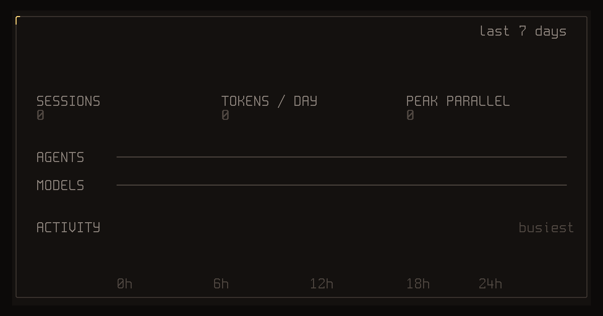

# agentflex

**一条命令，生成你这一周编程助手使用情况的动态卡片。**



```bash
npx agentflex
```

不用安装，不用注册，不上传任何数据。它读取本机 Claude Code、Codex、OpenCode 和 Pi 的历史记录，汇总最近 7 天，在终端里播放卡片。按 `s` 保存 1200×630 的 PNG 用来分享，`r` 重播，`q` 退出。

也可以用 `pnpm dlx agentflex` 或 `bunx agentflex` 运行。

## 卡片内容

- **Token 总量**：各助手自己记录的数，包含缓存读取。
- **会话数**、**每天 token** 和**最高并行会话数**（同一时刻同时在跑的会话最多有几个）。
- **助手占比**：Claude Code、Codex、OpenCode、Pi 各占多少。
- **活跃热力图**：按星期和小时排布，并标出最忙的时段。

## 选项

```bash
npx agentflex --month        # 最近 30 天
npx agentflex --all          # 全部保留的历史
npx agentflex --png week.png # 只导出图片后退出
npx agentflex --json         # 以 JSON 输出数据
npx agentflex --no-anim      # 不播放动画，直接显示最终卡片
```

## 快

在重度使用的机器上（约 900 MB 历史），默认 7 天的卡片不到 1 秒就统计完：多核并行读取，只读统计周期内的部分，只解析需要的字段。解析引擎是 [SessKit](https://github.com/x0c/sesskit) 的原生 `sesskit-stats`，并与 SessKit 的参考实现逐会话核对过。

## 平台

macOS（Apple 芯片、Intel）、Linux（x64、arm64）和 Windows（x64、arm64）。自动在各助手的标准位置查找历史，并支持 `CLAUDE_CONFIG_DIR`、`CODEX_HOME`、`XDG_DATA_HOME`、`OPENCODE_DB`、`PI_CODING_AGENT_DIR`、`PI_CODING_AGENT_SESSION_DIR`。

## 隐私

所有数据都留在你的电脑上。卡片只显示汇总数字，不显示提示词、文件名、项目名或路径。

## 来自 Corral 团队

agentflex 出自 [Corral](https://github.com/corral-dev/corral)：一个在终端里集中管理所有编程助手会话的工具，能看到谁在等你回复、并排运行多个助手，还能在手机上接着做。Corral 用户也可以直接运行 `corral flex`。

## 许可证

MIT。PNG 导出内嵌了 [Spleen](https://github.com/fcambus/spleen) 点阵字体的子集（BSD-2-Clause，见 `assets/SPLEEN-LICENSE.txt`）。
