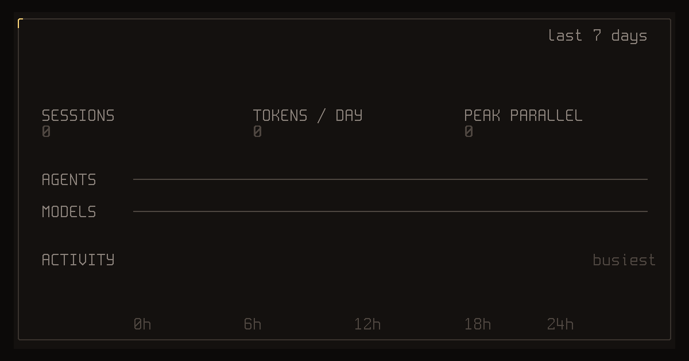

# agentflex

[](https://www.npmjs.com/package/agentflex) [](https://github.com/corral-dev/agentflex/blob/main/LICENSE)

**An animated card of your coding-agent week, in one command.**



```bash
npx agentflex
```

No install, no account, no upload. It reads the local histories of Claude Code, Codex, OpenCode, Pi and Google Antigravity, adds up the last 7 days, and plays the card in your terminal. Press `s` to save a 1200×630 PNG for posting, `r` to replay, `q` to quit.

Also works with `pnpm dlx agentflex` and `bunx agentflex`.

## What the card shows

- **Tokens** for the period, as each assistant recorded them (cache reads included).
- **Sessions**, **tokens per day** and **peak parallel sessions** (the most agent sessions active at the same moment).
- **Agent share** across Claude Code, Codex, OpenCode, Pi and Google Antigravity (by sessions).
- **Top models** by their share of your tokens, read from each recorded reply.
- **Activity** by weekday and hour, with your busiest hour.

## Options

```bash
npx agentflex --month        # last 30 days
npx agentflex --all          # all retained history
npx agentflex --png week.png # write the image and exit
npx agentflex --json         # print the numbers as JSON
npx agentflex --no-anim      # final card without animation
```

## Language

The card follows your locale. A Chinese locale (`zh_CN`, `zh-Hans`, …) shows the terminal card, loading state, key hints and exported PNG in Simplified Chinese; every other language keeps the English card. `CODING WEEK`, `tokens` and `AGENTS` stay in English as the card's own vocabulary.

```bash
LANG=zh_CN.UTF-8 npx agentflex   # force the Chinese card
LANG=en_US.UTF-8 npx agentflex   # force English
```

## Fast

The default 7-day card is computed in well under a second on a heavy-use machine (about 900 MB of history): histories are read in parallel, pruned to the period, and only the fields that matter are decoded. The parsing engine is [SessKit](https://github.com/x0c/sesskit)'s native `sesskit-stats` crate, checked session by session against SessKit's reference implementation.

## Platforms

macOS (Apple silicon, Intel), Linux (x64, arm64) and Windows (x64, arm64). Histories are found in each assistant's standard location; `CLAUDE_CONFIG_DIR`, `CODEX_HOME`, `XDG_DATA_HOME`, `OPENCODE_DB`, `PI_CODING_AGENT_DIR` and `PI_CODING_AGENT_SESSION_DIR` are honored.

## Privacy

Everything stays on your machine. The card shows totals only: no prompts, file names, project names or paths.

## From the makers of Corral

agentflex comes from [Corral](https://github.com/corral-dev/corral), a terminal home for all your coding-agent sessions: see who needs you, run agents side by side, and pick up from your phone. Corral users can also run `corral flex`.

Burning tokens across multiple accounts? [subswap](https://github.com/x0c/subswap) checks live quotas and switches accounts in 1 second.

## License

MIT. The PNG export embeds subsets of the [Spleen](https://github.com/fcambus/spleen) (BSD-2-Clause) and [Fusion Pixel](https://github.com/TakWolf/fusion-pixel-font) (OFL-1.1) bitmap fonts; licenses are in [assets/](https://github.com/corral-dev/agentflex/blob/main/assets/).
